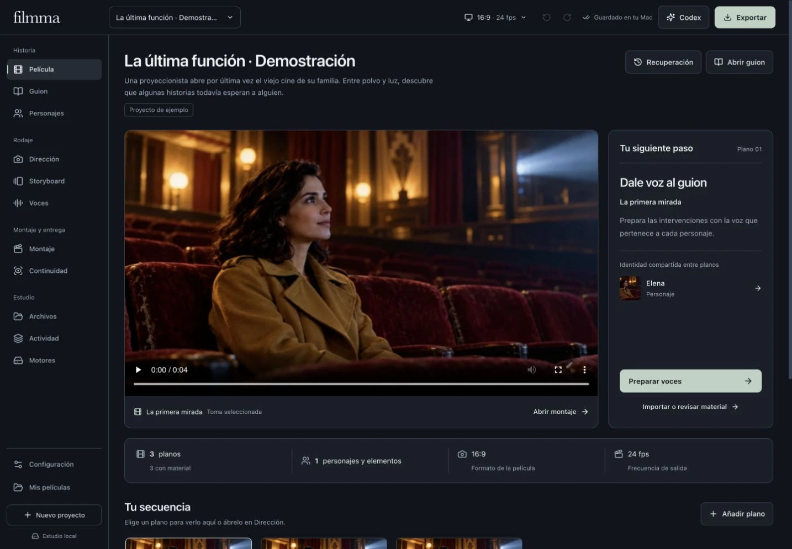
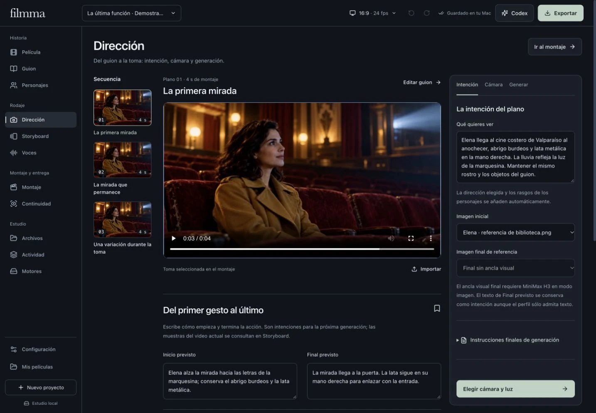
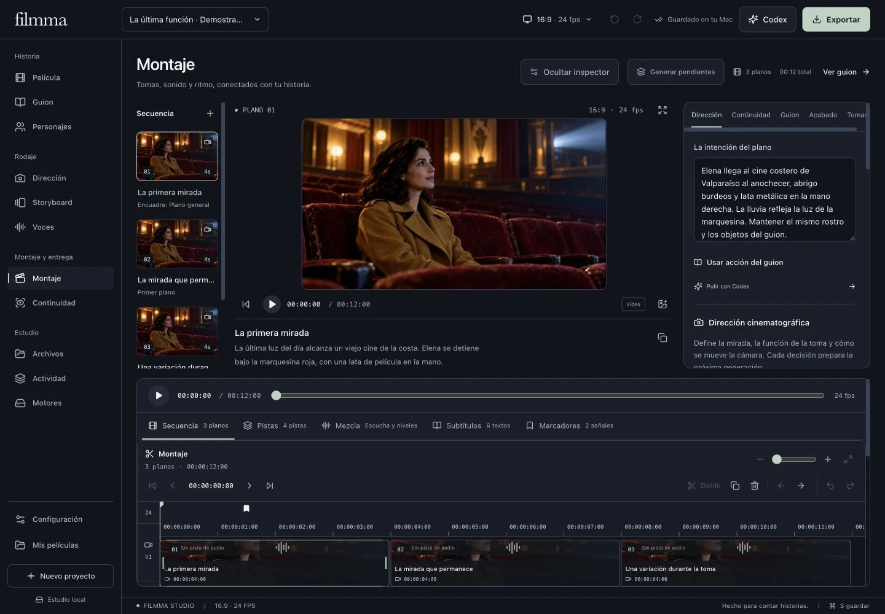
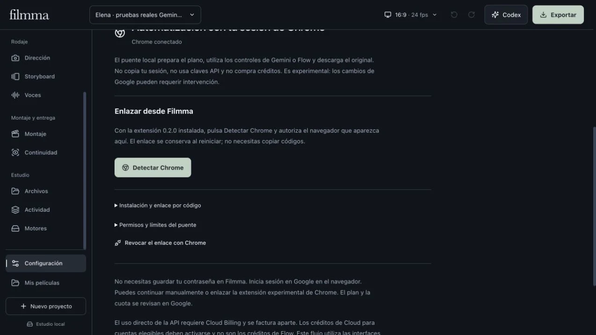

# Filmma

**Del guion al último fotograma, con tus personajes y tus originales siempre a mano.**

Filmma es un estudio de cine para Mac y Windows: escribe una historia, dirige sus planos, conserva las referencias de personajes y objetos, monta imagen y sonido y prepara la entrega. Combina generación local en Apple Silicon con un flujo opcional para tu sesión de Google AI Pro.

[Descargar para Mac y Windows](https://github.com/gabrielperezibacache/filmma/releases/latest) · [Guía de uso](docs/GUIA.md) · [Modelos locales](docs/LOCAL_MODELS.md) · [Google AI Pro](docs/GOOGLE-AI-PRO.md) · [Instalación, RAM y CUDA](docs/LOCAL_INSTALLATION.md)



*Capturas reales de la aplicación con «La última función», un proyecto de demostración. Sus personajes e imágenes son ficticios; los clips de demostración no acreditan una generación de Google.*

## Un estudio conectado a la historia

| Apartado | Qué puedes hacer |
| --- | --- |
| **Guion** | Organizar secuencias, escenas, acciones y diálogos. Mantener los planos conectados a su contexto narrativo. |
| **Personajes y objetos** | Conservar referencias visuales, rasgos, vestuario, accesorios y cambios intencionales entre escenas. |
| **Dirección y Storyboard** | Elegir cámara, lentes, encuadres, movimientos, película, época y referencias de dirección. Preparar el inicio y final de cada plano. |
| **Montaje** | Editar varias pistas, mover y recortar clips, agrupar selecciones, colocar marcadores y ajustar transiciones, velocidad y fotogramas clave. |
| **Voces y sonido** | Trabajar con Qwen TTS local, perfiles de voz a partir de referencias y ElevenLabs opcional. Mezclar audio y editar subtítulos vinculados al diálogo. |
| **Color y continuidad** | Comparar planos con scopes SDR y revisar varios fotogramas para detectar diferencias de rostro, vestuario y objetos. La revisión requiere criterio humano. |
| **Biblioteca** | Etiquetar, marcar favoritos, seguir la procedencia y reconectar copias idénticas de originales ausentes. |
| **Entrega** | Preparar copias de acabado con IA local, exportar hasta 4K y conservar el proyecto portable con sus originales. |





## Empezar en Mac

1. Descarga el **DMG arm64** de la [última versión](https://github.com/gabrielperezibacache/filmma/releases/latest). El repositorio y sus releases son privados: inicia sesión con una cuenta que tenga acceso.
2. Arrastra **Filmma** a Aplicaciones y ábrela. El paquete requiere **Apple Silicon y macOS 27 o posterior**. Tiene firma ad hoc; todavía no está notarizado con Developer ID.
3. Crea una película y escribe el primer plano. Añade personajes, imágenes y diálogos antes de generar.
4. En **Motores**, elige el almacenamiento, consulta la recomendación para tu equipo y prepara un modelo local; o utiliza **Dirección → Generar → Google AI Pro**.
5. Lleva la toma a **Montaje**, revisa la continuidad y exporta.

En **Configuración** puedes cambiar el idioma —español o inglés—, la apariencia, la escala, la navegación y las animaciones. La aplicación consulta las releases de GitHub y comprueba SHA256 al descargar una actualización. Los proyectos y los modelos se guardan fuera del paquete de la aplicación.

También puedes abrir la versión de desarrollo con `Abrir Filmma.command` o visitar `http://127.0.0.1:4318` cuando el servidor local esté iniciado.

## Empezar en Windows

Descarga **Filmma-…-win-x64-Setup.exe** de Releases y comprueba `SHA256SUMS.txt`. El instalador por usuario incluye Python y multimedia, permite elegir carpeta y conserva proyectos y modelos al actualizar o desinstalar. También hay ZIP x64. La distribución aún no tiene firma Authenticode. Consulta [compatibilidad, memoria e instalación](docs/LOCAL_INSTALLATION.md).

El editor, guion y exportación son multiplataforma. Los motores integrados Metal y MLX requieren Apple Silicon. En Windows/Linux se documentan H3 con Diffusers + CUDA + RAM/INT8 y alternativas ligeras externas; no se anuncian como adaptadores integrados ni como inferencia Windows ya verificada. El diagnóstico distingue RAM del sistema de VRAM y evita recomendar H3 a equipos insuficientes.

En Mac, el selector de residencia mantiene SSD streaming en 36 GB y permite un transformador residente desde 64 GiB, con 96 GiB recomendados y una prueba breve acotada. No convierte pesos, no vuelve a descargarlos y no relaja los límites existentes de HD/tomas largas.

## Generar con tu cuenta Google AI Pro

Filmma ofrece dos recorridos que conservan el mismo guion, referencias y procedencia:

- **Asistido:** prepara un ZIP con el prompt y las imágenes elegidas; genera en Gemini o Flow y vuelve con el video descargado.
- **Puente de Chrome —experimental—:** una extensión local prepara el trabajo en Google y contempla la captura del video de Gemini. La extensión 0.2.0 permite detectarla y autorizarla desde Filmma; el enlace se conserva al reiniciar. El código sigue como alternativa. Flow mantiene su confirmación por toma y sus referencias mediante selector nativo; el puente incorpora la recepción acotada de «Tamaño original» desde Descargas, pendiente de verificación con la extensión real. La prueba autónoma de la extensión sigue pendiente del enlace; consulta [el estado de las pruebas](docs/GOOGLE-AI-PRO.md).

El puente **no usa la API de pago, no copia cookies ni contraseñas y no compra créditos**. Emplea el acceso y los límites de tu suscripción. No garantiza disponibilidad ni generaciones ilimitadas. Si aparece login, CAPTCHA, un acuerdo, falta de cuota o un control ambiguo, se detiene. Una solicitud ya enviada no se repite automáticamente.

Cada toma conserva el contexto con el que se preparó. Si cambió el guion, un personaje o una referencia, el resultado queda como alternativa para revisar. Filmma comprueba el archivo, mide sus fotogramas y registra SHA256; esa comprobación no garantiza la identidad visual de un personaje ni certifica por sí sola la autoría externa.

La prueba real del 28 de octubre de 2026 produjo e importó dos originales de **720p y 24 fps**: Gemini de **10 s / 240 fotogramas**, Flow de **8 s / 192 fotogramas**. Se usaron los controles visibles de Chrome, la misma referencia ficticia de Elena y un paquete de Filmma por plano. Se verificaron decodificación completa, SHA256, audio y vínculos; esto acredita el recorrido asistido, separado del enlace persistente de la extensión aún pendiente.



## Modelos, equipo y calidad

| Componente | Requisitos y alcance |
| --- | --- |
| **Edición, guion y biblioteca** | Funcionan sin descargar un modelo de video. La generación externa necesita Internet. |
| **MiniMax H3 local** | Motor comunitario `h3.c` con Metal. Aproximadamente **144 GB** de pesos base y **66 GB** adicionales para referencias. Los perfiles para 36 GB transmiten bloques desde SSD y supervisan memoria y presión del sistema. |
| **LTX-Video 2B distilled** | Alternativa local con MLX, aproximadamente **25,4 GB** de pesos. No genera audio nativo. |
| **Acabado local 4K** | Copias separadas con Real-ESRGAN y perfiles de restauración, incluida compensación temporal. Requiere el motor de acabado preparado. |
| **Voces** | Qwen local reutiliza una instalación compatible; ElevenLabs necesita su propia clave y cuenta. La sincronización labial requiere el modelo local correspondiente. |

El equipo de referencia es un **MacBook M4 Max de 36 GB**. Un SSD externo es recomendable para MiniMax; el gestor comprueba espacio y mantiene una reserva. El tamaño del modelo en disco no equivale a la memoria de inferencia.

Los clips generados o importados mediante el flujo Google tienen un máximo de **15 segundos**. Cada motor puede imponer límites inferiores según duración, resolución, referencias y memoria. Proporción y fps de exportación se configuran por película; se conserva la cadencia del archivo original.

**Exportar en 4K no convierte una fuente pequeña en generación nativa 4K.** Separa resolución de generación, copia de acabado y lienzo final. Los perfiles experimentales no prometen tiempo ni calidad sin una toma medida. Consulta [resolución nativa y evidencia](docs/NATIVE_RESOLUTION.md) y [restauración estable](docs/STABLE_RESTORATION.md).

## Tus originales y tus proyectos

Filmma guarda copias de los archivos importados y crea versiones nuevas para generaciones, restauración y sincronización labial. Recortar un clip, cambiar una referencia o ajustar color modifica el montaje; no sobrescribe la fuente.

- **Mis películas:** abrir proyectos guardados o importar un paquete Filmma.
- **Recuperación:** checkpoints y restauración de versiones verificables.
- **Biblioteca:** integridad, procedencia y reconexión por coincidencia SHA256.
- **Exportación de proyecto:** ZIP portable con escritura, vínculos y medios originales. Las conexiones privadas y los modelos no se incluyen.

El estudio local utiliza `data/project.json`, `data/projects/`, `data/media/` y `data/exports/`. Los trabajos, parciales y descargas del puente se guardan por separado. **No borres `data/` para actualizar.** Guarda una copia del proyecto exportado y conserva también tus medios fuente.

## Codex como asistente de producción

La CLI oficial de Codex puede ayudar a proponer guion, afinar prompts y revisar continuidad usando su autenticación local. El conector MCP de Filmma permite trabajar con el proyecto y enviar imágenes ya generadas al estudio. No convierte una suscripción en acceso universal a APIs de imagen o video. [Configuración y límites](docs/CODEX.md).

## Desarrollo

Requisitos: **Node.js 22**, npm y FFmpeg/FFprobe en el `PATH`. Python y los entornos MLX/Metal se preparan según el motor elegido; consulta las guías antes de descargar pesos.

```bash
npm ci
npm run dev
```

- Interfaz Vite: `http://127.0.0.1:4317`.
- API local: `http://127.0.0.1:4318`.
- Versión compilada: `npm run build` y después `npm start`.
- Stack: React 19, TypeScript, Vite, Express, Motion y Lucide.

```bash
npm run check
node --import tsx --test --test-concurrency=2 tests/*.test.ts
```

Las pruebas verifican edición, exportación, integridad, contexto narrativo, recuperación, conexiones y protocolos del puente con archivos técnicos y proveedores simulados. **No equivalen a haber generado un video real en Google o a haber ejecutado el instalador.** La compatibilidad de los servicios se registra con evidencias independientes.

El workflow [Filmma for Mac](https://github.com/gabrielperezibacache/filmma/actions/workflows/macos-release.yml) compila el runtime multimedia portable, ejecuta la suite y publica DMG, ZIP y sumas SHA256. Los pesos, las credenciales y los proyectos privados no se suben al repositorio.

## Guías y alcance

[Uso](docs/GUIA.md) · [Modelos](docs/LOCAL_MODELS.md) · [Voces](docs/VOICES-RUNTIME.md) · [Google](docs/GOOGLE-AI-PRO.md) · [Ajustes y actualizaciones](docs/APPLICATION_SETTINGS.md) · [Plan y pendientes](docs/DEVELOPMENT-PLAN.md)

Filmma no incorpora el código propietario de Higgsfield ni presenta todos sus modelos comerciales como funciones locales. El análisis con REA y la distinción entre observaciones e inferencias se documentan en [ingeniería inversa](docs/REVERSE_ENGINEERING.md). El software de terceros conserva sus licencias; consulta [las atribuciones del paquete Mac](docs/THIRD_PARTY_MAC.md).
