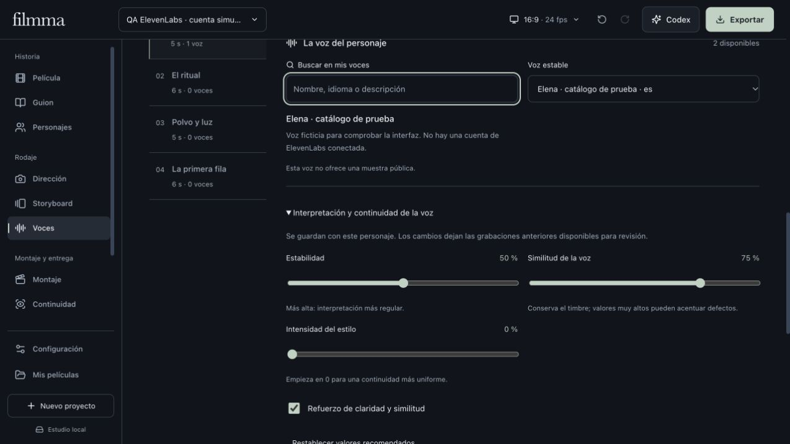

# ElevenLabs en Filmma

*Captura de la aplicación con un catálogo simulado y un personaje ficticio. No representa una cuenta conectada ni una voz real de ElevenLabs.*

## Conectar tu cuenta

1. Abre **Voces → Voces y conexiones → ElevenLabs · tu cuenta**.
2. Crea una clave en [ElevenLabs](https://elevenlabs.io/app/settings/api-keys) con acceso a **Text to Speech**, lectura de voces y lectura de modelos. Lectura de usuario es opcional para consultar el consumo. Puedes limitar los créditos de la clave en ElevenLabs.
3. Pega la clave únicamente en Filmma y pulsa **Conectar cuenta**. Se consulta el catálogo; no se genera una prueba de pago.
4. **Actualizar mis voces** actualiza voces, modelos y consumo. El consumo mostrado corresponde a esa consulta, no a un saldo en tiempo real. Si la clave no permite leer la suscripción, Filmma puede funcionar sin mostrarlo.

La clave queda en el archivo privado de proveedores del usuario, fuera del proyecto, sus copias y exportaciones. En macOS se guarda con permisos privados del usuario; en Windows se cifra con DPAPI y queda vinculada al usuario de Windows. Tras trasladar ese archivo a otra cuenta o equipo, vuelve a conectar ElevenLabs. El navegador recibe un catálogo filtrado, nunca la clave. **Desconectar** retira la conexión y conserva todas las grabaciones. La cuenta y sus créditos API son de ElevenLabs; una suscripción de Codex o Google no los sustituye.

## Dar una voz a cada personaje

En una intervención del guion, selecciona **ElevenLabs · mi cuenta** como motor. Busca por nombre, idioma o descripción y elige **Voz estable**. La muestra pública, cuando existe, se reproduce bajo demanda desde ElevenLabs y no genera una síntesis nueva. Algunas voces no tienen muestra; un fallo al reproducirla no cambia la voz guardada.

La voz pertenece al personaje y se comparte entre escenas. La narración puede tener una selección propia. Filmma conserva el identificador de voz, modelo, idioma, ritmo y ajustes de interpretación:

| Control | Valor inicial | Uso |
| --- | --- | --- |
| Estabilidad | 50 % | Una interpretación más regular al subirla; más variación al bajarla. |
| Similitud | 75 % | Mantener el timbre. Un valor alto también puede acentuar defectos. |
| Intensidad del estilo | 0 % | Aumentar deliberadamente la expresividad del estilo. |
| Refuerzo de claridad | Activado cuando es compatible | Refuerzo de claridad y similitud. |
| Ritmo | 1× cuando es compatible | Rango de Filmma: 0,7–1,2×. |

Sólo aparecen modelos devueltos por tu cuenta y compatibles con el idioma. Filmma contempla Multilingual v2, Flash v2.5, Turbo v2.5, v3, v4 y v4 Turbo. **Multilingual v2 permanece como selección inicial** para conservar los proyectos existentes. v4 y v4 Turbo no reciben velocidad numérica, estilo ni speaker boost. v3 ofrece tres posiciones de estabilidad y omite speaker boost. Los ajustes se envían en cada solicitud; no modifican la configuración global de la voz en ElevenLabs.

Cambiar voz, modelo, ajustes, texto o continuidad del personaje deja las grabaciones anteriores disponibles y las marca para revisión. Abrir un proyecto antiguo no añade valores nuevos a sus perfiles ni invalida sus grabaciones.

### Dirigir cada intervención

En **Texto → Intención de la voz** puedes elegir cercanía, duda, curiosidad, tensión contenida, consuelo, urgencia, intimidad, cansancio o una interpretación reflexiva. **Natural** conserva la lectura sin una indicación añadida. La intención cambia por intervención; el identificador de voz permanece en el personaje.

Estas indicaciones requieren **Eleven v4, v4 Turbo o v3**. Filmma envía una etiqueta breve de actuación junto al texto; las indicaciones no se guardan como palabras del guion ni aparecen en los subtítulos. No se envían instrucciones largas que el modelo pueda terminar leyendo. Las intenciones antiguas desconocidas se conservan para revisión y deben sustituirse antes de generar.

Cambiar la intención deja la grabación anterior para revisión. Escucha cada resultado: el modelo puede omitir palabras, repetirlas o interpretar una etiqueta de manera inesperada. La dirección no garantiza por sí sola una actuación correcta. Si los tiempos del proveedor incluyen la etiqueta, Filmma no los presenta como tiempos de habla fiables; conserva el audio con alineación no disponible.

## Del guion al montaje

1. Revisa **Texto que se pronuncia**, personaje, plano y entrada.
2. Pulsa **Generar en ElevenLabs**. Sólo se envían ese texto, la intención elegida cuando corresponde y los parámetros de voz; no se suben las imágenes, videos, referencias biométricas ni fichas del personaje.
3. Escucha la nueva grabación y pulsa **Usar voz en montaje** cuando la apruebes. Cada versión queda separada en la biblioteca.
4. **Crear subtítulo con esta voz** utiliza los límites del habla cuando hay tiempos válidos; conserva el texto del guion. En Montaje puedes editar el texto y volver a usar los tiempos sin perder tus cambios.
5. Para sincronizar labios, selecciona una toma con el personaje visible y usa esa misma grabación vigente. Se crea otra copia; el original permanece disponible. Cambiar la interpretación exige revisar la sincronización anterior.

La síntesis utiliza PCM mono de 24 kHz y publica un WAV nuevo, validado con FFprobe y decodificación completa. Cada intervención admite hasta **600 caracteres y 15 segundos**. Un audio más largo se rechaza completo: Filmma no lo recorta para aparentar que cabe. Si no cabe en el plano, ajusta la entrada o divide la intervención antes de aplicarla.

Las solicitudes de generación consumen créditos y **no tienen reintentos automáticos**. Cancelar o recibir una respuesta larga, inválida o tardía no garantiza que ElevenLabs no haya cobrado. Filmma rechaza destinos existentes antes de solicitar la síntesis y no sobrescribe originales.

## Tiempos de habla y procedencia

Filmma solicita el endpoint `with-timestamps` y valida audio base64/PCM, longitud de las listas, orden y límites de sus tiempos. Conserva alineación por carácter, modelo, identificador de solicitud cuando está disponible, texto, configuración y huella del audio junto a los vínculos de plano y personaje.

La alineación original debe corresponder al texto enviado. Si sólo sirve la alineación normalizada, queda identificada como tal y nunca reemplaza el guion. Los subtítulos usan la primera y última posición hablada; no se afirma que esto sea una transcripción o una partición automática por palabras. Si no llegan tiempos válidos, el audio se conserva con estado **sin alineación** y los subtítulos usan su duración completa. Los originales no se recortan para quitar silencios.

## Verificación y límites

La integración se verifica con respuestas simuladas de la API, WAV reales de prueba, exportación/importación, cancelación, claves restringidas, errores, cambios de cuenta y continuidad. La revisión de interfaz utiliza un proyecto aislado y un catálogo rotulado como simulado; no representa una voz real de ElevenLabs. La prueba autenticada y la evaluación perceptual de sus voces quedan pendientes de conectar tu cuenta.

Referencias oficiales: [autenticación](https://elevenlabs.io/docs/api-reference/authentication), [permisos de claves](https://elevenlabs.io/docs/overview/administration/workspaces/api-keys), [modelos](https://elevenlabs.io/docs/overview/models), [controles por modelo](https://github.com/elevenlabs/skills/blob/main/text-to-speech/references/voice-settings.md) y [voz con tiempos](https://elevenlabs.io/docs/api-reference/text-to-speech/convert-with-timestamps).
