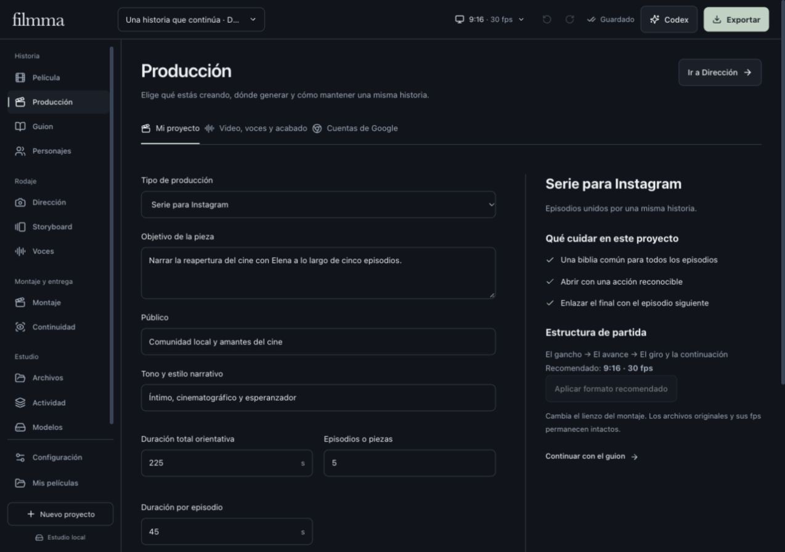

# Producción: de la idea a una toma coherente

Abre **Producción** desde la navegación o desde el resumen de la película. La configuración se guarda con el proyecto; el guion, los personajes y los originales existentes se conservan.

*Proyecto ficticio de demostración. Las cuentas de las pruebas son simuladas; no acredita una generación con dos cuentas reales.*

## 1. Mi proyecto

Elige **Documental, Largometraje, Cortometraje, Serie para Instagram, Comercial, Video promocional, Historia de Instagram, Videoclip, Video educativo o Proyecto libre**. Completa objetivo, público, tono y notas. La sugerencia a partir del título o la idea es una ayuda por palabras clave: sólo se aplica al pulsarla.

Cada recorrido propone estructura, prioridades y formato. Un documental distingue hechos y recreaciones; una serie comparte la biblia de personajes entre episodios; la publicidad fija el producto y la llamada a la acción. El contexto entra en las instrucciones locales, el paquete Google y el contexto enviado al asistente de guion Codex. No se envían rutas locales de modelos ni datos de las cuentas.

Los proyectos nuevos reciben una estructura inicial vacía. Una serie parte con cinco episodios, unidos por el mismo proyecto y personajes. Cambiar el tipo de un proyecto existente no crea ni reemplaza sus escenas: organízalas desde Guion.

**Duración total y por episodio son metas del montaje.** No prometen una generación de esa duración. Cada clip generado mantiene un máximo de 15 segundos y los límites inferiores de su modelo. El proyecto conserva su límite de 100 planos; los largometrajes se planifican por secuencias y pueden requerir varios proyectos.

**Aplicar formato recomendado** cambia el lienzo y los fps del montaje, con la validación habitual para no perder tiempos de subtítulos y fotogramas clave. Los originales mantienen sus dimensiones, bytes y cadencia.

## 2. Video, voces y acabado

| Trabajo | Elección | Dónde funciona |
| --- | --- | --- |
| Video | LTX-Video o MiniMax H3 | Pesos locales, con comprobación de memoria y compatibilidad |
| Video | Google Flow o Gemini | Sesión de una cuenta en un perfil de Chrome |
| Diálogo | Qwen TTS | Modelo existente de Hermes, reutilizado sin duplicar pesos |
| Diálogo | Kokoro | Modelo local de voces predefinidas |
| Diálogo | ElevenLabs | Cuenta propia y clave privada local; sólo el texto se envía al servicio |
| Acabado | Real-ESRGAN | Copia local de mejora, separada del original |
| Sincronización labial | MuseTalk | Copia nueva vinculada al diálogo y a la voz del personaje |

La preferencia de voz sirve para personajes y narraciones nuevos. Las voces existentes no se sustituyen. Cada personaje conserva su selección y sus audios; Qwen requiere una referencia válida y ElevenLabs una voz disponible en la cuenta.

Dirección recuerda el origen de video elegido. Al elegir Google, las acciones de generación local de Montaje llevan a preparar la toma en Dirección; no envían un trabajo a otro motor por accidente. Las generaciones Google se revisan individualmente, con sus referencias y perfil de cuenta.

## 3. Cuentas de Google

1. Abre un perfil distinto de Chrome para cada cuenta. Inicia sesión en Flow desde ese perfil; Chrome puede usarse sin activar su sincronización.
2. Carga **Filmma Bridge 0.3.0** en cada perfil. Si ya usas `public/google-browser`, recarga esa extensión. No cambian los permisos.
3. En **Producción → Cuentas de Google**, indica un nombre local y pulsa **Detectar Chrome → Enlazar este perfil**. El código temporal queda como alternativa.
4. Usa **Abrir Flow en este perfil** para revisar la cuenta, el modelo y sus créditos sin generar. El perfil debe aparecer conectado; la orden puede tardar hasta treinta segundos.
5. En **Dirección → Generar → Google AI Pro**, prepara el paquete, elige el perfil y revisa las referencias antes de enviar una toma.

Se pueden mantener hasta doce perfiles enlazados. Filmma identifica el perfil de Chrome; no verifica por sí mismo el titular de la cuenta de Google. Usa una cuenta por perfil y comprueba el titular en Google. Cada cuenta conserva su acceso, plan y límites. **No se agrupan cuotas ni se rota automáticamente de cuenta al agotarse los créditos.**

Una toma queda ligada al perfil que la recibió. Cambiar el perfil predeterminado no la traslada. Otro perfil no puede reclamarla, enviar eventos ni escribir sus archivos aunque conozca su identificador. Si cambia el guion o la continuidad, el original se conserva como alternativa. La recuperación no vuelve a generar.

La revocación invalida el enlace, sin borrar cookies ni medios. Con la extensión 0.3.0, volver a enlazar el mismo perfil conserva su identificador local para recuperar sus tomas. Los enlaces antiguos se migran conservando una copia del registro anterior.

### Cookies y almacenamiento

Las cookies y la sesión permanecen bajo el control del perfil local de Chrome. Filmma no las extrae, no recibe sus valores y no las sube a ningún servidor. No añade permisos de cookies, historial o debugger a la extensión. El acceso autenticado a un medio usa la sesión del propio navegador.

Filmma guarda sólo el vínculo local: resumen del token, identificador del perfil y nombre que tú eliges. La extensión conserva el token de enlace en `chrome.storage.local`. Ninguno de estos datos se incluye en el ZIP de película ni se incorpora a sus prompts.

Ubicaciones dentro de la carpeta de datos de Filmma:

- `.application-private/google-browser.json`: registro privado de enlaces, sin cookies ni tokens en claro.
- `.application-private/google-profiles/<id>/`: metadatos de cada perfil. **Esta carpeta no es el almacén de cookies de Chrome.**
- `google-browser/downloads/`: originales y parciales conservados.
- `engine-registry/<motor>/`: ficha local del motor, ubicación de sus pesos o información del servicio remoto.

Cada modelo local mantiene su ruta original, incluso si está en SSD externo o en Hermes. El registro no duplica, mueve ni borra pesos. Los modelos remotos no se presentan como instalados: sus carpetas contienen metadatos. El puente puede registrar el modelo que aparece seleccionado en un control inequívoco de Google; eso acredita una configuración observada, no el motor interno que Google finalmente ejecutó. Los modelos que devuelve la cuenta ElevenLabs reciben fichas separadas.

### Alcance de la comprobación

Se probaron selección y separación de perfiles, tokens, migración, reconexión, recuperación, paquetes con referencias, persistencia del contexto y exportación/importación del proyecto con datos ficticios. La revisión visual cubre escritorio y móvil. Se consultó además el menú real de modelos de Flow sin iniciar otra generación. No se afirma una generación real nueva con dos cuentas Google distintas.

Flow puede requerir adjuntar referencias, aprobar cada toma o confirmar el guardado nativo. Cambios de interfaz, acceso o cuota se comunican para continuar en Google; una petición enviada no se repite automáticamente.

Fuentes oficiales consultadas el 29 de octubre de 2026: [perfiles de Chrome](https://support.google.com/chrome/answer/2364824?hl=es), [perfiles de Chromium](https://www.chromium.org/developers/creating-and-using-profiles/) y [créditos de Flow por cuenta](https://support.google.com/flow/answer/16526234?hl=es).
