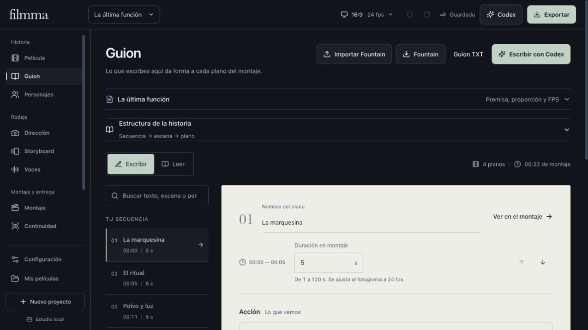
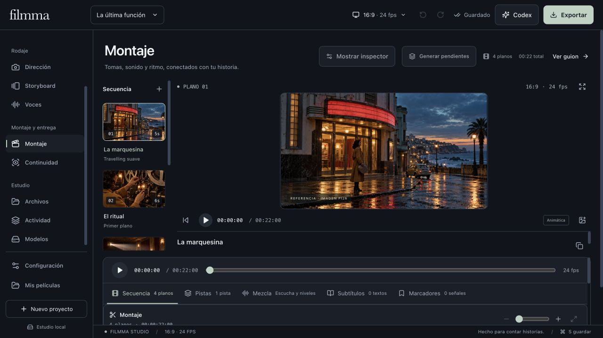

# Interfaz de Filmma: revisión integral

La interfaz conserva la dirección visual «sala de dailies»: tinta azul, jade, imágenes como centro del trabajo y papel para escribir el guion. Los controles de operación comparten ahora escala tipográfica, espaciado, foco y tamaños de interacción. Las referencias visuales y sus originales permanecen intactos.

*Capturas de la aplicación con un proyecto de ejemplo, personajes ficticios e imágenes de referencia. No acreditan una generación nueva de video.*

| Apartado | Revisión |
| --- | --- |
| Película | Jerarquía, siguiente paso, secuencia y adaptación a pantallas estrechas. |
| Guion | Contraste de campos sobre papel, identificación de campos, foco y edición conservada al reintentar un guardado. |
| Personajes | Ficha, referencias, formularios, controles y presentación en móvil. |
| Dirección | Secuencia, cámara, formularios y controles compartidos de generación. |
| Storyboard | Título identificable, lectura de planos y acceso al guion cuando todavía no hay planos. |
| Voces | Título, conexiones, legibilidad de los campos y acceso al guion desde el estado vacío. |
| Montaje | Visor con más espacio en escritorio, acceso vertical a la línea de tiempo, paneles y controles táctiles. |
| Continuidad | Jerarquía de revisión y acceso a personajes y referencias cuando falta material. |
| Archivos | Búsqueda, filtros, detalle y acción de importar cuando la biblioteca está vacía. |
| Actividad | Mensaje neutral cuando no hay trabajos, estados y acceso para dirigir una toma. |
| Modelos | Configuración de generación separada de instalación y pruebas, sin cambios en los límites del motor. |
| Configuración | Accesos a voces locales, ElevenLabs y Codex junto a la conexión existente de Google. |

## Interacción y guardado

- Estado de guardado visible en escritorio y en la barra de historial móvil; un fallo ofrece **Reintentar**.
- Mensaje de desconexión en español o inglés, sin reintentos automáticos de solicitudes.
- Foco en el título del apartado incluso cuando éste carga de forma diferida; enlace para saltar al área de trabajo.
- Las ventanas mantienen el foco en controles visibles, cierran con Escape y devuelven el foco al botón de origen. Escape respeta los campos que ya lo usan para deshacer una edición pendiente.

## Comprobación

Se recorrieron los doce apartados a 1280 y 390 píxeles de ancho, sin desbordamiento horizontal del documento ni del área principal. El campo de título del guion, con los colores comprobados en Cinema, presenta una relación de contraste de 13,25:1. Se comprobaron también el tema claro, el ciclo de foco de Exportar, los accesos desde estados vacíos y una interrupción real del servidor QA seguida de reintento de guardado sin perder la edición.

Pasaron **526 pruebas** y la compilación de producción. El proyecto principal y los nueve originales multimedia protegidos conservaron sus hashes. No se iniciaron generaciones, descargas de modelos ni peticiones de síntesis de pago.

La evidencia local está en `output/qa/studio-polish/`: capturas por apartado, medidas de interfaz y `verification.json`. Las muestras de Cinema, Grafito, Luz de día y Sistema conservan sus colores propios: son representaciones deliberadas de temas alternativos, no colores nuevos aplicados a la interfaz Cinema. No se suprimieron avisos del detector ni se regeneró la documentación del sistema de diseño como efecto secundario.
